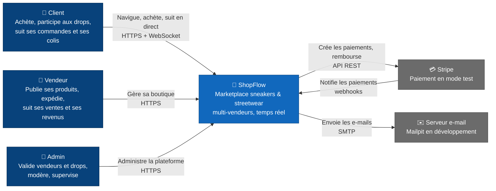
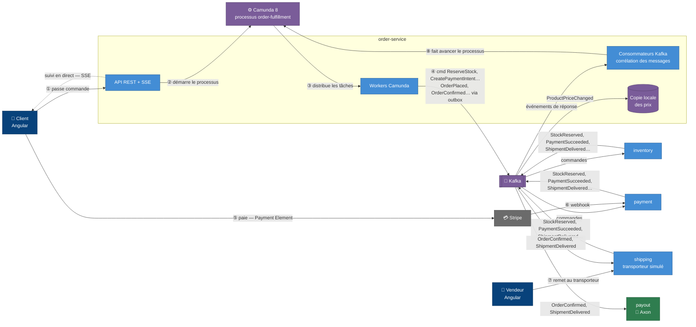

# 04 — Architecture (modèle C4)

Trois vues : le **contexte** (ShopFlow vu de l'extérieur), les **conteneurs** (l'intérieur, regroupé par domaine) et un **zoom sur la commande**. Le diagramme de déploiement viendra avec Kubernetes (phase 12).

## ① Contexte

Le **transporteur** et la **banque** (virements SEPA) sont simulés à l'intérieur de ShopFlow : ce ne sont pas des systèmes externes.

## ② Conteneurs

```mermaid
flowchart TB
    users["👤 Client · Vendeur · Admin"]

    spa["🖥️ Frontend<br/>Angular SPA"]
    gw["🚪 API Gateway<br/>Spring Cloud Gateway<br/>routage, JWT, rate limiting"]
    kc["🔐 Keycloak<br/>identité, rôles"]

    subgraph services["Microservices Spring Boot — architecture hexagonale"]
        direction LR
        subgraph d1["Catalogue & stock"]
            catalog["catalog"]
            inventory["inventory"]
        end
        subgraph d2["Achat"]
            cart["cart"]
            wishlist["wishlist"]
            order["order<br/>⚙️ Camunda"]
            payment["payment"]
            shipping["shipping"]
        end
        subgraph d3["Vendeurs"]
            usersvc["user<br/>⚙️ Camunda"]
            payout["payout<br/>📜 Axon"]
        end
        subgraph d4["Engagement"]
            promotion["promotion<br/>⚙️ Camunda"]
            review["review"]
            loyalty["loyalty"]
            notification["notification"]
        end
        subgraph d5["Data"]
            analytics["analytics<br/>Kafka Streams"]
        end
    end

    subgraph infra["Infrastructure"]
        direction LR
        kafka[["📨 Kafka<br/>+ Schema Registry (Avro)"]]
        mongo[("🍃 MongoDB<br/>replica set<br/>une base par service")]
        redis[("⚡ Redis<br/>paniers, drops, cache")]
        camunda["⚙️ Camunda 8<br/>Zeebe, Operate, Tasklist"]
        minio[("🖼️ MinIO<br/>images")]
        axon[("📜 Event store Axon<br/>Axon Server ou MongoDB<br/>à décider en 5.9")]
    end

    stripe["💳 Stripe"]
    mail["✉️ E-mail"]

    users --> spa
    spa -->|"connexion OIDC"| kc
    spa -->|"REST, SSE, WebSocket"| gw
    gw -->|"vérifie les JWT"| kc
    gw -->|"REST, SSE, WebSocket"| services
    services <-->|"événements et commandes<br/>CloudEvents + Avro"| kafka
    services -->|"données + outbox"| mongo
    cart & promotion & catalog --> redis
    order & usersvc & promotion -->|"processus BPMN"| camunda
    catalog & review --> minio
    payout --> axon
    payment <-->|"API + webhooks"| stripe
    notification -->|"SMTP"| mail

    classDef person fill:#08427b,stroke:#052e56,color:#ffffff
    classDef container fill:#438dd5,stroke:#2e6295,color:#ffffff
    classDef process fill:#2f7d4f,stroke:#1f5535,color:#ffffff
    classDef store fill:#7a5c99,stroke:#55406b,color:#ffffff
    classDef external fill:#6b6b6b,stroke:#4d4d4d,color:#ffffff
    class users person
    class spa,gw,catalog,inventory,cart,wishlist,payment,shipping,review,loyalty,notification,analytics container
    class order,usersvc,promotion,payout process
    class kafka,mongo,redis,minio,axon,camunda,kc store
    class stripe,mail external
```

**Légende :** ⚙️ porte un processus Camunda · 📜 Event Sourcing (Axon) · en vert, les services porteurs d'un processus ou d'un event store.

## ③ Zoom : le parcours d'une commande

Le détail du processus BPMN (timers, compensations, sous-commandes en parallèle) est dans [02-event-storming.md](02-event-storming.md#parcours-1--achat-classique).
